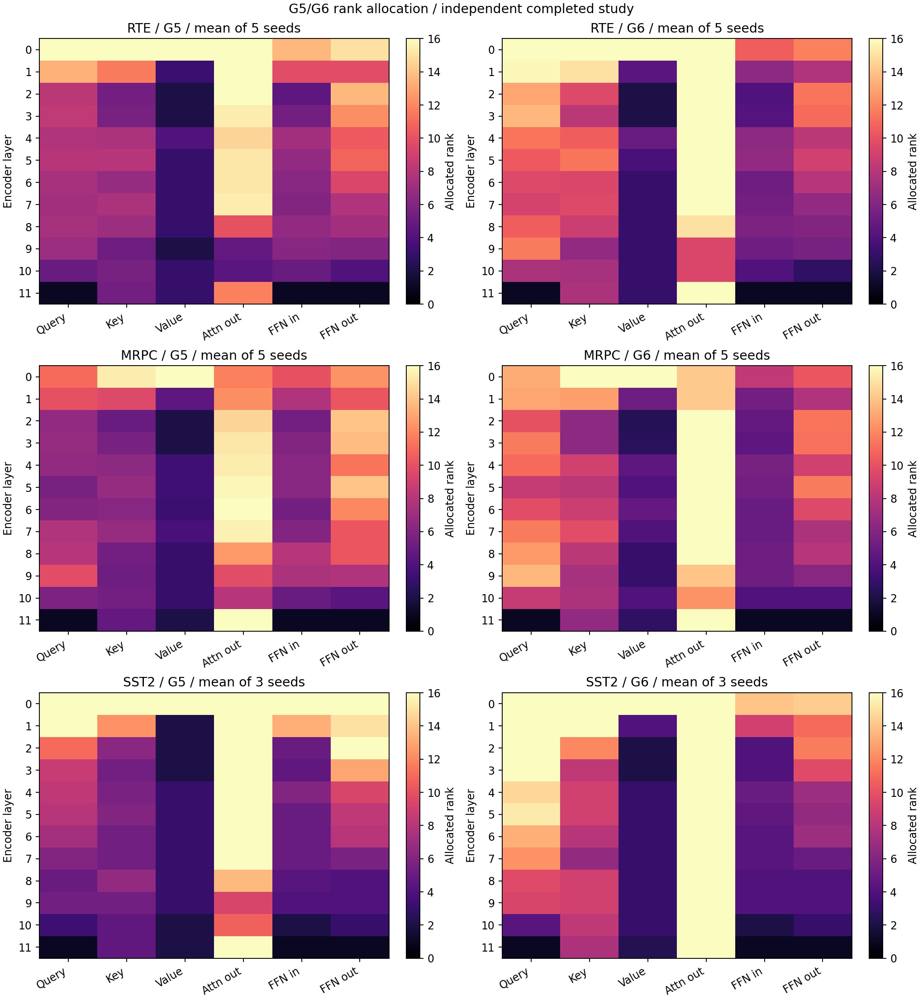
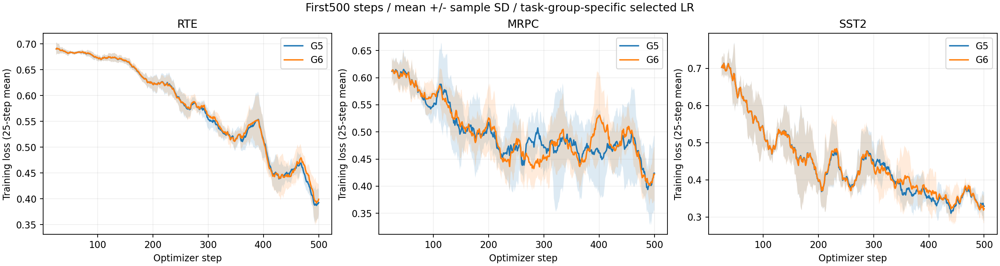

<p align="right"><b>English</b> | <a href="README.zh-CN.md">中文</a></p>

# G5 / G6: Gradient-Weighted EVA

Owner: Yanze Han. Branch: `hanyanze`. RoBERTa-base on GLUE RTE, MRPC and SST-2; **26 completed main runs and 18 final-grid tuning runs**.

**Protocol status: independent study, not a shared-protocol rerun.** The completed experiments use length512, RTE/MRPC/SST-2 epochs80/30/10, full-train final fitting, and a different split/LR grid. The current repository convention uses length128, epochs10/10/3 and the90% training portion. These results must not be directly paired with G3/G4/G7. See the [protocol and differences](docs/protocol.zh-CN.md). Historical measurements have not been relabelled or changed.

## Method

After one epoch of head-only warm-up, freeze the encoder and head. Enable gradients on embedding outputs to build the calibration graph. At each of72 Linear outputs, collect per-token gradients, remove padding and form `z = ||g||_2 x`. Gradients of the mean loss are multiplied by the actual microbatch size. This targets the **uncentered** second moment `E[||g||²xxᵀ]`, not centered PCA of weighted rows.

The CPU streaming SVD merges retained rows with new rows and truncates to16 directions; each merge SVD is exact, the historical rank truncation is approximate. G5 globally selects576 ranks using layer-normalized spectral energy. G6 solves an exact prefix-constrained integer knapsack for1,327,104 LoRA parameters. Both use unit-row A, zero B and the same warmed-up head/cache; alpha scales with allocated rank to preserve alpha/r=1. Classification-head parameters are counted separately.

## Results

Official validation, mean ± sample SD, percentages:

| Task / metric | Seeds | G5 | G6 |
|---|---:|---:|---:|
| RTE accuracy | 5 | 78.84 ± 2.00 | 78.84 ± 0.91 |
| MRPC accuracy | 5 | 88.04 ± 1.31 | 88.38 ± 1.72 |
| MRPC F1 | 5 | 91.37 ± 0.95 | 91.68 ± 1.17 |
| SST-2 accuracy | 3 | 93.92 ± 0.23 | 93.43 ± 0.73 |

All three same-seed accuracy-difference 95% t intervals include zero. This is not evidence of equivalence. G5 has 1,281,024–1,352,448 LoRA parameters, versus exactly 1,327,104 for G6; parameter matching is imperfect. There is no original-EVA/LoRA baseline in this run set, so it does not establish GW-EVA superiority. [Analysis](docs/analysis.zh-CN.md) · [raw per-run results](results/main/) · [CSV](results/g56_runs.csv).




## Layout

```text
G5G6/
  src/gw_eva/     independent calibration, SVD, allocation and training modules
  jobs/           download, queue, optional Slurm template, summarize and plots
  tests/          offline numerical tests and result-integrity checks
  configs/        pinned model/data revisions and exact holdout membership
  docs/           mathematical scope, protocol differences and concise report
  results/        26 main +18 tune JSONs, spectra/ranks, summaries and figures
```

## Run

Run from `G5G6/`. Use a separate environment; the recorded server used Python3.12 and torch2.8.0+cu128.

```bash
python -m venv .venv
source .venv/bin/activate
pip install torch==2.8.0 --index-url https://download.pytorch.org/whl/cu128
pip install -r requirements.txt
pip install -e . --no-deps
python tests/test_tiny.py
python tests/test_results.py
python jobs/prefetch.py
bash jobs/run_queue.sh --tasks rte
# Then --tasks mrpc and --tasks sst2, or omit --tasks on an unrestricted server.
python jobs/summarize.py
python jobs/plot_diagnostics.py
```

Native PEFT EVA is not needed: this independent extension uses PEFT0.12.0 for adapter injection/save/load. Full training requires a CUDA GPU with BF16 support; the recorded4090 resource probe passed batch32/length512. `jobs/g56.sbatch` is an optional unexecuted cluster template; adapt account/partition and submit one task per job. Checkpoints save adapter/optimizer/scheduler/RNG at full epoch boundaries; completed jobs are skipped.

The source/data revision pins and SHA256s are in `configs/`. Private endpoints, credentials, pretrained weights, raw datasets, binary caches/checkpoints and machine-bound environments are excluded from git. Complete binary artifacts remain in the verified local backup. [Result-schema notes](results/README.md).

Reference algorithms: [EVA](https://github.com/ml-jku/EVA), [PEFT EVA](https://github.com/huggingface/peft/blob/main/src/peft/tuners/lora/eva.py). The token-level second-moment surrogate does not include cross-token terms in the squared sequence-level gradient; see [mathematical scope](docs/protocol.zh-CN.md).
