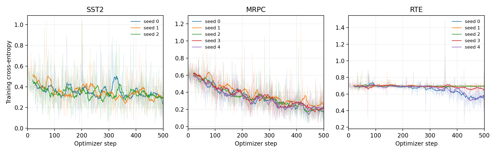

# G7 LoRA-GA: team-protocol results

Completed: **13/13 main runs**, **9/9 tuning runs**.

Results use the last epoch. Accuracy and F1 below are percentages; ± denotes sample standard deviation across seeds. MRPC's primary metric is F1. Hyperparameters are selected on the internal dev split.

| Task | Seeds | LR | Accuracy | F1 |
|---|---:|---:|---|---|
| SST2 | 3/3 | 0.0002 | 93.96 ± 0.46 | — |
| MRPC | 5/5 | 0.0002 | 88.53 ± 0.74 | 91.83 ± 0.46 |
| RTE | 5/5 | 0.0002 | 56.68 ± 8.85 | — |

## Same-seed differences

Differences are G7 minus the reference, in percentage points. The two-sided 95% interval uses Student t with n−1 degrees of freedom. Completed seed intersections are listed explicitly.

| Reference | Task | Paired seeds | Primary difference | 95% CI |
|---|---|---|---|---|
| G3 | SST2 | 0, 1, 2 | -0.23 ± 0.90 | [-2.45, +2.00] |
| G3 | MRPC | 0, 1, 2, 3, 4 | -0.19 ± 0.46 | [-0.76, +0.37] |
| G3 | RTE | 0, 1, 2, 3, 4 | -18.12 ± 8.65 | [-28.87, -7.38] |
| G4 | SST2 | 0, 1, 2 | +0.31 ± 0.58 | [-1.13, +1.74] |
| G4 | MRPC | 0, 1, 2, 3, 4 | +0.33 ± 0.71 | [-0.55, +1.20] |
| G4 | RTE | 0, 1, 2, 3, 4 | -16.90 ± 7.93 | [-26.74, -7.05] |

**G7−G3:** SST2, MRPC intervals include zero; RTE intervals lie below zero.

**G7−G4:** SST2, MRPC intervals include zero; RTE intervals lie below zero.

Reference measurements: `yinchenyu_g3g4` at `26616379899f0abce7d693e227ad4e03138312ab`. The scalar source metrics and file paths are preserved in [reference_metrics.json](reference_metrics.json). The experimental protocol is shared; hardware and library versions are recorded for each run. G3/G4 used an A40 and torch 2.11 / Transformers 5.21 / PEFT 0.21; this G7 run uses an L40S and the project's Python 3.9 environment (torch 2.4 / Transformers 4.52 / PEFT 0.17). G3 redistributes ranks and its actual adapter count varies; this comparison retains those recorded counts.

## Tuning

All candidates use seed 0 and the final dev metric. Equal primary scores select the smaller learning rate.

| Task | LR | Final dev primary (%) | Chosen |
|---|---:|---:|---|
| SST2 | 0.0002 | 95.04 | yes |
| SST2 | 0.0005 | 94.11 | no |
| SST2 | 0.001 | 92.61 | no |
| MRPC | 0.0002 | 91.75 | yes |
| MRPC | 0.0005 | 90.74 | no |
| MRPC | 0.001 | 83.12 | no |
| RTE | 0.0002 | 66.27 | yes |
| RTE | 0.0005 | 48.19 | no |
| RTE | 0.001 | 48.19 | no |

### Learning-rate sensitivity

The 2e-4 candidate has the highest final dev primary score on all three tasks. Increasing LR from 2e-4 to 1e-3 reduced that score by SST2 2.44 pp, MRPC 8.63 pp, RTE 18.07 pp. This is the observed learning-rate sensitivity of G7 under the shared α/r=1, no-clipping setting.

For RTE, the 5e-4 and 1e-3 runs stayed at 48.19/51.81% dev accuracy across epochs; their last 50 stored-step mean losses were 0.6952/0.6949, with finite losses throughout the stored trace. The 48.19/51.81% plateau is consistent with single-class prediction on the fixed dev split (an inference from aggregate scores). The selected 2e-4 run reached 66.27% at the required last epoch. These records show a finite-loss learning plateau at the higher rates.

## Initialisation and parameter checks

The following measurements cover completed tuning and main runs. Logit error compares the warmed-up base with the compensated LoRA-GA model on the same calibration batch; weight error is the maximum across `W_residual + (α/r)B₀A₀ − W₀` over all target layers.

| Task | Runs | Calibration samples | Layers / rank / scaling | LoRA / head parameters | Max budget deviation | Max logits error | Max weight error |
|---|---:|---|---|---|---:|---:|---:|
| SST2 | 6 | 1024 | 72 / 8 / 1.0 | 1,327,104 / 592,130 | 0.00% | 1.609e-05 | 5.960e-08 |
| MRPC | 8 | 1024 | 72 / 8 / 1.0 | 1,327,104 / 592,130 | 0.00% | 3.695e-06 | 5.960e-08 |
| RTE | 8 | 1024 | 72 / 8 / 1.0 | 1,327,104 / 592,130 | 0.00% | 9.984e-07 | 5.960e-08 |

## Per-run results

Times are seconds; peak memory is PyTorch's maximum allocated GPU memory in GiB. Total includes loading, head warm-up, initialisation, training and evaluation.

| Task | Seed | Accuracy (%) | F1 (%) | Init s | Total s | Peak GiB | Step-0 B gradient |
|---|---:|---:|---:|---:|---:|---:|---:|
| SST2 | 0 | 94.50 | — | 2.71 | 223.00 | 1.55 | 33.36 |
| SST2 | 1 | 93.69 | — | 2.75 | 222.51 | 1.55 | 48.52 |
| SST2 | 2 | 93.69 | — | 2.95 | 248.90 | 1.55 | 96.36 |
| MRPC | 0 | 88.97 | 92.04 | 2.79 | 48.37 | 2.08 | 3.415 |
| MRPC | 1 | 88.48 | 91.80 | 3.57 | 50.23 | 2.09 | 5.879 |
| MRPC | 2 | 88.24 | 91.67 | 3.54 | 49.50 | 2.08 | 7.684 |
| MRPC | 3 | 87.50 | 91.19 | 3.99 | 50.25 | 2.08 | 7.337 |
| MRPC | 4 | 89.46 | 92.44 | 3.60 | 53.61 | 2.08 | 14.01 |
| RTE | 0 | 66.43 | — | 5.69 | 47.67 | 2.38 | 4.491 |
| RTE | 1 | 47.29 | — | 6.41 | 50.59 | 2.38 | 3.11 |
| RTE | 2 | 49.46 | — | 5.96 | 49.32 | 2.38 | 1.3 |
| RTE | 3 | 54.87 | — | 6.40 | 50.40 | 2.38 | 1.757 |
| RTE | 4 | 65.34 | — | 5.72 | 43.83 | 2.38 | 1.695 |

| Task | Mean init s | Mean total s | Mean peak GiB | LoRA parameters |
|---|---|---|---|---|
| SST2 | 2.80 ± 0.13 | 231.47 ± 15.10 | 1.55 ± 0.00 | 1327104.00 ± 0.00 |
| MRPC | 3.50 ± 0.44 | 50.40 ± 1.96 | 2.08 ± 0.00 | 1327104.00 ± 0.00 |
| RTE | 6.03 ± 0.35 | 48.36 ± 2.79 | 2.38 ± 0.00 | 1327104.00 ± 0.00 |

## RTE prediction breakdown

These are measured predictions from the selected-LR main runs on all 277 official validation examples.

| Seed | Predicted label 0 | Predicted label 1 | Accuracy (%) |
|---|---:|---:|---:|
| 0 | 213 | 64 | 66.43 |
| 1 | 0 | 277 | 47.29 |
| 2 | 218 | 59 | 49.46 |
| 3 | 191 | 86 | 54.87 |
| 4 | 184 | 93 | 65.34 |

At the selected LR 2e-4, seed 1 predicted label 1 for every validation example (277/277), yielding 47.29% accuracy. This is a directly observed single-class prediction failure. Its stored first-500-step losses are finite, with a mean of 0.6954 over the final 50 stored steps.

RTE accuracy spans 47.29–66.43%, with mean ± SD 56.68 ± 8.85%. The two lowest results are seed 1 (47.29%) and seed 2 (49.46%). These measured low-performing runs contribute to the low mean and large seed variation.

## Execution and verification

Slurm job **48482** finished **COMPLETED**, exit code `0:0`, in **1179 seconds**. 2 processes shared 1 allocated NVIDIA L40S GPU, with 8 CPUs and 28 GiB host memory. [Scheduler record](scheduler.json).

Verification recomputed all **6,041** predictions from **13** main runs, checked label order and the shared configuration, and confirmed finite first-500-step traces for all **22** runs. [Verification record](verification.json).

## First 500 steps

Thin lines show individual batches; thick lines show a 20-step moving mean. Each task has its own y-axis. Curves include main runs at the selected learning rate.

[PDF figure](first500-loss.pdf)

[Protocol and reproduction instructions](../README.md)
