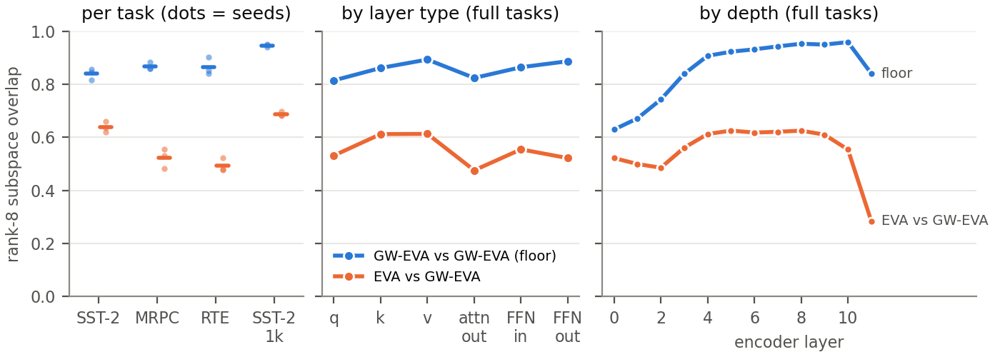
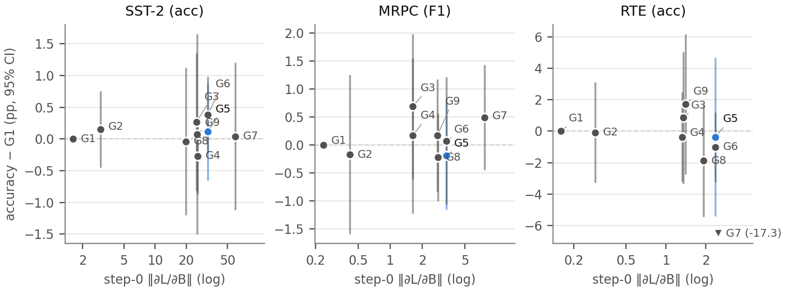
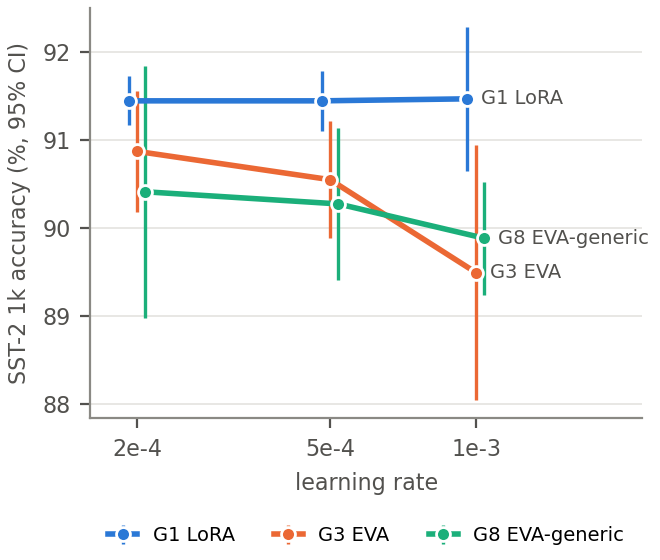
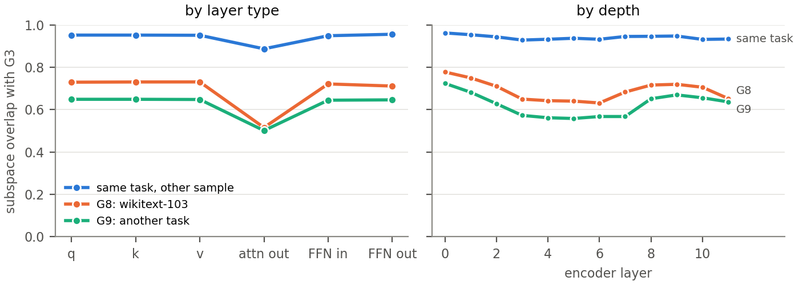

<p align="right"><b>English</b> | <a href="README.zh-CN.md">中文</a></p>

# GW-EVA: Gradient-Weighted LoRA Initialisation Without the Independence Assumption

AI6103 Deep Learning group project (Option 2: improve on an existing codebase), team of six.

- **Base paper**: EVA (Paischer et al., NeurIPS 2025). It initialises LoRA's A matrix with the principal components of layer activations and redistributes ranks across layers by explained variance.
- **Codebase**: the authors' official repository (MIT licence) and the EVA implementation in Hugging Face PEFT.
- **Our change**: we drop one independence assumption from EVA's optimality proof, derive a gradient-weighted initialisation, **GW-EVA**, and implement it on top of PEFT.

## At a glance

| | |
|---|---|
| **Status (2026-11-20)** | All nine groups (G1–G9) and the H1 diagnosis are done and merged; about 230 runs, paired by seed |
| **Main result** | The theory holds and GW-EVA picks a genuinely different subspace from EVA, but neither GW-EVA nor any other data-aware initialisation beats plain LoRA on final accuracy at a tuned learning rate |
| **Paper story** | Analysis paper: "the gradient-weighted subspace is different, but it does not matter for the final accuracy; the benefits are early and transient" |
| **Read first** | [Report draft](summary/REPORT_DRAFT.md) · [Cross-group summary](summary/SUMMARY.md) · [All tables](summary/tables.md) · [Interactive results page](#6-interactive-results-page) · [How to run the code](RUN.md) |

Hypothesis verdicts: **H1 supported** (the subspaces differ), **H2 not supported** (GW-EVA = EVA in accuracy), **H3 not supported** (allocation does not matter), **H4 answered** (the subspace is task-specific but accuracy does not depend on it). Details in [§5](#5-results).

## Quick start: open the results page

The results page is a static HTML page in [`summary/site/`](summary/site/). It needs no build step and no packages. From the repository root:

```bash
python -m http.server 8000 --directory summary/site
```

Then open http://localhost:8000 in a browser. Or just double-click `summary/site/index.html`. Section [§6](#6-interactive-results-page) has the details.

## 1. Research question

EVA's optimality result (Theorem 3.2) assumes that the layer-output gradient $g = \partial L / \partial y$ is statistically independent of the input activation $x$.

Without this assumption, the gradient signal that B receives at initialisation (B = 0) is exactly:

$$
\mathbb{E}\left\Vert \frac{\partial L}{\partial B}\right\Vert _F^2 = \mathrm{Tr}\left(A\,\Sigma_g\,A^\top\right),\qquad
\Sigma_g = \mathbb{E}\left[\Vert g\Vert^2\, x x^\top\right]
$$

The optimal A is therefore the top-r eigenvectors of $\Sigma_g$, which we call **GW-EVA**. When $\Vert g\Vert^2$ is independent of $x$, it reduces to EVA.

For a mini-batch of size m:

$$
\mathbb{E}\left\Vert \bar G_m A^\top\right\Vert _F^2 = \tfrac{1}{m}\mathrm{Tr}\left(A\Sigma_g A^\top\right) + \left(1-\tfrac{1}{m}\right)\left\Vert \mathbb{E}[g x^\top]A^\top\right\Vert _F^2
$$

The direction that maximises the second term is exactly the mean-gradient direction used by LoRA-GA. EVA, GW-EVA and LoRA-GA are therefore solutions of the same objective under different assumptions.

A second thread asks how much task information a LoRA initialisation needs. Ordered from least to most task information, four initialisations form a line:

generic corpus (G8) → another task's inputs (G9) → this task's inputs (G3, EVA) → this task's inputs + label gradients (G5, GW-EVA)

## 2. Hypotheses

| | Hypothesis | If it fails |
|---|---|---|
| **H1** | In RoBERTa-base, $\Vert g\Vert^2$ is correlated with $x$, and the top-r subspaces of $\Sigma_g$ and of the activation covariance differ measurably (week 1, no training needed) | Empirical support for EVA's assumption; GW-EVA reduces to EVA and we report a negative result |
| **H2** | At equal parameter count, GW-EVA has a larger step-0 gradient, lower loss over the first 500 steps and higher accuracy than EVA, with a paired 95% CI excluding 0 at least in the low-resource setting | The extra backward pass is not worth it |
| **H3** | Allocating ranks by explained variance per parameter, instead of per rank, changes the result under a fixed parameter budget (a controlled factor, not a novelty claim) | EVA's original per-rank allocation is sufficient |
| **H4** | EVA's activation subspace carries task-specific information: calibrating on a generic corpus or another task changes both the subspace and the accuracy | Activation statistics are mostly determined by the model, so task information can only enter through label gradients, which strengthens the case for GW-EVA |

## 3. Experimental groups

The core is a 2×2 factorial design, direction × allocation (G3–G6), plus reference groups.

| Group | Direction of A | Rank allocation | Question answered | Folder | Status |
|---|---|---|---|---|---|
| G1 LoRA | Kaiming random | Uniform r = 8 | Baseline | [`G1G2/`](G1G2/) | Done |
| G2 magnitude control | Random orthonormal, row norms matched to EVA | Uniform r = 8 | Do gains come from direction or magnitude? | [`G1G2/`](G1G2/) | Done |
| G3 EVA | Activation covariance | By rank count (original, ρ = 2) | Reproduce the original method | [`G3G4/`](G3G4/) | Done |
| G4 | Activation covariance | By parameter cost | Allocation only (H3) | [`G3G4/`](G3G4/) | Done |
| G5 GW-EVA | $\Sigma_g$ | By rank count | Direction only (H2) | [`G5G6/`](G5G6/) | Done (shared settings; low-resource 3 seeds) |
| G6 GW-EVA | $\Sigma_g$ | By parameter cost | Direction and allocation combined | [`G5G6/`](G5G6/) | Done (shared settings; low-resource 3 seeds) |
| G7 LoRA-GA | Mean gradient (B ≠ 0, rewrites W) | Uniform r = 8 | Representative of the second term | [`G7/`](G7/) | Done |
| G8 EVA-generic | Activation covariance on a generic corpus (wikitext-103) | By rank count | Task-agnostic end (H4) | [`G8/`](G8/) | Done (incl. low-resource) |
| G9 EVA-cross | Activation covariance from another task (SST-2←MRPC, MRPC←RTE, RTE←MRPC) | By rank count | How task-specific are the inputs? (H4) | [`G9/`](G9/) | Done |

**Model and tasks**: RoBERTa-base on GLUE SST-2, MRPC and RTE, plus a 1,000-example low-resource SST-2 subset (G1, G3, G5, G6, G8).

**H1 diagnosis** (no training): for each task and seed, EVA and GW-EVA are computed on the same 1,024 calibration examples and their top-8 subspaces compared in all 72 layers, against a noise floor from two disjoint samples. Folder [`H1 Diagnosis/`](H1%20Diagnosis/).

**LoRA placement and budget**: all 72 attention and FFN linear layers, with a fixed budget of **1,327,104** trainable parameters (the count for uniform r = 8).

## 4. Shared experimental settings

Every group must use these settings so that runs can be compared pairwise by seed. The reference implementation is `data.py` and `train.py` in `G3G4/src/`; G1/G2 reuse them directly.

| Setting | Value |
|---|---|
| Learning-rate grid | 2×10⁻⁴, 5×10⁻⁴, 1×10⁻³ |
| Seeds | 0–2 for SST-2, 0–4 for MRPC / RTE; seed 0 for tuning |
| Epochs | SST-2 3, MRPC 10, RTE 10, low-resource 20 |
| Batch size / max length / warm-up ratio / weight decay | 32 / 128 / 6% / 0; bf16 mixed precision; no gradient clipping |
| LoRA α / dropout | α = 8 (α/r = 1) / 0; after EVA's redistribution PEFT scales α with the rank so that α/r is unchanged |
| Classification-head warm-up | Encoder frozen, 1 epoch, learning rate 1×10⁻³ |
| Dev split | 10% of the training set, `SPLIT_SEED = 2026`; the low-resource 1k subset uses seed 2027 |
| Final training data | The remaining 90%, the same as during tuning |
| EVA calibration | 1,024 random training examples, batch 16, labels removed; τ = 0.99, ρ = 2 |
| Selection and reporting | Last epoch; hyperparameters chosen on dev; the official validation set is used only for the final evaluation |
| Low-resource learning rate | Each group reuses the learning rate it chose on full SST-2 |
| Result format | One JSON per run; fields as at the end of `G3G4/src/train.py` |
| Statistics | Same-seed paired differences with 95% confidence intervals (t distribution, df = n − 1) |
| Metrics | Accuracy for SST-2 / RTE, F1 and accuracy for MRPC; step-0 ‖∂L/∂B‖ and loss over the first 500 steps; initialisation time, total time, peak memory |

Learning rates chosen on the dev split (seed 0); low resource reuses each group's full-SST-2 choice:

| Group | SST-2 | MRPC | RTE |
|---|---|---|---|
| G1 | 5e-4 | 2e-4 | 5e-4 |
| G2 | 5e-4 | 1e-3 | 2e-4 |
| G3 | 1e-3 | 2e-4 | 2e-4 |
| G4 | 5e-4 | 2e-4 | 2e-4 |
| G5 | 1e-3 | 2e-4 | 2e-4 |
| G6 | 5e-4 | 2e-4 | 2e-4 |
| G7 | 2e-4 | 2e-4 | 2e-4 |

G8 / G9 reuse G3's learning rates.

## 5. Results

All groups ran under the shared settings above and are paired by seed. Full tables, paired differences, caveats and the open items are in [`summary/SUMMARY.md`](summary/SUMMARY.md), regenerated by `python summary/collect.py`.

Official validation, mean ± sd (%); SST-2 3 seeds, MRPC / RTE 5, low resource 5 (G5/G6: 3):

| Task | G1 LoRA | G2 | G3 EVA | G4 | G5 GW-EVA | G6 | G7 LoRA-GA | G8 | G9 |
|---|---|---|---|---|---|---|---|---|---|
| SST-2 (acc) | 93.92 ± 0.00 | 94.07 ± 0.24 | 94.19 ± 0.43 | 93.65 ± 0.24 | 94.04 ± 0.30 | **94.30 ± 0.24** | 93.96 ± 0.46 | 93.88 ± 0.46 | 94.00 ± 0.63 |
| MRPC (F1) | 91.34 ± 0.43 | 91.16 ± 1.11 | **92.02 ± 0.79** | 91.50 ± 0.68 | 91.14 ± 0.69 | 91.41 ± 0.52 | 91.83 ± 0.46 | 91.11 ± 0.34 | 91.50 ± 0.60 |
| RTE (acc) | 73.94 ± 2.10 | 73.86 ± 1.04 | 74.80 ± 2.49 | 73.57 ± 2.06 | 73.57 ± 2.43 | 72.92 ± 2.09 | 56.68 ± 8.85 | 72.06 ± 2.18 | **75.67 ± 1.70** |
| Low-res SST-2 1k (acc) | **91.44 ± 0.28** | – | 88.81 ± 0.83 | – | 88.46 ± 0.29 | 89.98 ± 0.18 | – | 89.89 ± 0.52 | – |

Paired differences (percentage points, 95% CI; `*` = interval excludes 0):

| Comparison | SST-2 | MRPC | RTE | Low resource |
|---|---|---|---|---|
| G5 − G3 (H2) | −0.15 [−1.07, +0.76] | −0.88 [−2.05, +0.29] | −1.23 [−4.09, +1.64] | −0.46 [−3.82, +2.90] |
| G3 − G1 | +0.27 [−0.81, +1.35] | +0.68 [−0.60, +1.97] | +0.87 [−3.27, +5.01] | −2.64 [−3.70, −1.57] * |
| G5 − G1 | +0.11 [−0.64, +0.87] | −0.20 [−1.14, +0.75] | −0.36 [−5.35, +4.63] | −3.10 [−3.59, −2.60] * |
| G7 − G1 | +0.04 [−1.11, +1.19] | +0.49 [−0.44, +1.41] | −17.26 [−27.93, −6.59] * | – |
| G3 − G1, both at lr 2e-4 on one GPU⁵ | – | – | – | −0.57 [−1.45, +0.30] |

| Hypothesis | Verdict |
|---|---|
| H1: Σ_g's subspace differs from EVA's | **Supported**: on the same calibration sample the top-8 subspaces overlap 0.49–0.69 against a GW–GW noise floor of 0.84–0.95, significant on all four tasks (`H1 Diagnosis/`) |
| H2: GW-EVA beats EVA | **Not supported**: G5 − G3 non-significant everywhere, means slightly negative, and no lower early loss, although GW-EVA's step-0 gradient is 1.3–2.1× EVA's |
| H3: cost-based allocation matters | **Not supported**: G4 − G3 and G6 − G5 non-significant; EVA with uniform ranks matches the original in low resource |
| H4: how task-specific the inputs are | **Answered**: EVA calibrated on another task (G9) or on generic wikitext-103 text (G8) matches EVA on task data in accuracy, although its subspace overlaps by only 0.49–0.72 against a same-task noise floor of 0.92–0.95 |

⁵ From the low-resource controls in [`summary/SUMMARY.md`](summary/SUMMARY.md), outside the shared protocol; 2e-4 is EVA's best low-resource learning rate, and G1 gives the same result at every learning rate tried.

Main findings:

- **GW-EVA's subspace really differs from EVA's (H1).** On the same calibration sample the top-8 subspaces overlap 0.49–0.69, against 0.84–0.95 between two GW-EVA estimates from disjoint samples; only 7 of 864 layer-seed pairs reach the floor. Per token, ‖g‖² is only weakly correlated with ‖x‖² (Pearson 0.10–0.19).
- **No initialisation beats plain LoRA on full data.** All groups except G7 are within ±1.9 points of G1, and every interval contains 0. That includes EVA calibrated on another task (G9) or on generic text (G8).
- **Data-aware inits fit faster early, but the gain does not last.** At equal lr on MRPC, EVA, GW-EVA and LoRA-GA all have a significantly lower training loss than LoRA over the first 500 steps, with no difference in final F1. GW-EVA is no faster than EVA at any stage.
- **Larger initial gradients do not buy accuracy.** The step-0 gradient on B grows 7–37× from G1 to the data-aware inits; matching only EVA's magnitude (G2) or its directions (G3) or adding label gradients (G5) leaves accuracy flat.
- **With 1k examples, spectral inits are worse than LoRA only because of the learning rate.** Under the shared rule G3 trails G1 by 2.64 (G5 −3.10, G6 −1.57, G8 −1.56). LoRA is insensitive to the learning rate while EVA prefers a lower one: with both at 2e-4 the gap shrinks to −0.57, not significant. Removing EVA's rank redistribution changes nothing; the loss curves show EVA fitting more slowly in steps 51–200 at the high learning rate.
- **On one GPU and at equal learning rate, EVA helps only on RTE.** The apparent MRPC edge with ten seeds came from mixing GPUs (with 15 seeds all on L40S, G3 − G1 = +0.14, not significant). On RTE at lr 2e-4, G3 − G1 = +2.13 [+0.97, +3.29]; at LoRA's own tuned lr (5e-4) the difference is not significant.
- **RTE is fragile.** LoRA-GA averages 56.68 there (one seed predicts a single class, two are near chance), but plain LoRA also collapsed on 1 of 10 seeds once G1 was extended to ten; see [`summary/SUMMARY.md`](summary/SUMMARY.md) §2, finding 7.
- **Where A points barely matters.** Gradient weighting (H1) and calibration on other data (H4: G8 overlaps EVA 0.64–0.72, G9 0.49–0.66, against a floor of 0.92–0.95) each move a third to a half of EVA's subspace, and neither changes accuracy.

### Figures

Generated by `python summary/figures.py` into [`summary/figures/`](summary/figures/) (PNG and PDF); numbered as in the report draft.

| | |
|---|---|
|  | **Figure 1. H1.** Overlap of GW-EVA with EVA on the same sample (orange) against the GW-EVA noise floor (blue), per task and by layer type and depth. |
|  | **Figure 2.** Step-0 ‖∂L/∂B‖ (log) against the accuracy difference to LoRA: the gradient grows 7–37×, accuracy does not move. |
|  | **Figure 3.** Low-resource SST-2 accuracy against learning rate on one GPU: LoRA is flat, EVA recovers at lower learning rates. |
|  | **Figure 4. H4.** Overlap with same-task EVA for a disjoint same-task sample, G8 and G9, by layer type and depth. |

### Known limitations

- H1 compares centred EVA with uncentred Σ<sub>g</sub>, so centring and gradient weighting are not yet separated.
- GPUs differ between groups (A40, L40S, a laptop GPU); single seeds move by up to 2.5 points across GPUs, so the findings rest on same-GPU checks.
- G5/G6 have only three low-resource seeds and no low-resource learning-rate controls.
- No correction for multiple comparisons (about 20 per table).

The full list, with what each caveat affects, is in [`summary/SUMMARY.md`](summary/SUMMARY.md) §3–4.

## 6. Interactive results page

[`summary/site/`](summary/site/) holds an English results page for presentations and for checking numbers. It shows every result above with interactive charts, and computes the paired 95% intervals in the browser the same way as `collect.py`.

| File | Role |
|---|---|
| `index.html` | The page: HTML, CSS and plain JavaScript, no libraries |
| `data.js` | Every run, the H1/H4 overlaps and the loss curves, generated from the run JSONs |
| `build_data.py` | Regenerates `data.js` (standard library only) |

**Open it**, either way:

1. **Directly.** Double-click `summary/site/index.html`, or from the repository root run `open summary/site/index.html` (macOS), `xdg-open summary/site/index.html` (Linux) or `start summary\site\index.html` (Windows). The page loads `data.js` from the same folder, so it also works offline; without a connection only the web fonts fall back to system fonts.
2. **Through a local server** (Python 3, nothing to install):

   ```bash
   python -m http.server 8000 --directory summary/site
   ```

   Then open http://localhost:8000. Use another port if 8000 is taken, and stop the server with Ctrl+C.

**What is on the page:**

| Section | Content |
|---|---|
| 01 Verdict | H1–H4 verdicts and the main findings |
| 02 Groups | The nine initialisations; colour = family of A's direction, marker = group |
| 03 Main results | Pick a task and a baseline (G1, G3 or G5): forest plot of paired differences, every seed, mean ± sd table |
| 04 Low resource | Accuracy against learning rate for G1, G3, G8 (and G5/G6 at their shared learning rates) |
| 05 Same-GPU checks | The comparisons rerun on one GPU and at equal learning rates |
| 06 Early training | Loss curves of the first 500 steps, with window differences against a chosen reference |
| 07 Step-0 gradient | Step-0 ‖∂L/∂B‖ against accuracy, and the √3 theory check |
| 08 Subspaces (H1) | GW-EVA vs EVA per task, a per-task table with CIs, and a layer type × depth heatmap |
| 09 Subspaces (H4) | Overlap of G8, G9 and the noise floor with same-task EVA, per task and per layer |
| 10 Setup & caveats | Shared settings, caveats and the commands to regenerate everything |

Hover any mark for its exact values. The page follows the system light/dark theme and works on a phone.

**After new runs**, regenerate the data from the repository root and reload the page:

```bash
python summary/site/build_data.py
```

It reads the same run JSONs as `collect.py` (`*/results/…` and `H1 Diagnosis/results/`) and rewrites `summary/site/data.js`. If the charts stay empty, check that `data.js` exists next to `index.html`.

## 7. Documents

| File | Contents |
|---|---|
| [`summary/REPORT_DRAFT.md`](summary/REPORT_DRAFT.md) | Full English report draft: method, design, results (Tables 1–7, Figures 1–4), discussion; TODOs mark what still needs the team |
| [`summary/SUMMARY.md`](summary/SUMMARY.md) | Cross-group summary: ten findings, hypothesis verdicts, comparability caveats, open items |
| [`summary/tables.md`](summary/tables.md) | Every generated table, including all paired differences and controls |
| [`summary/all_runs.csv`](summary/all_runs.csv) | One row per shared-protocol run |
| [`summary/NEXT_STEPS.md`](summary/NEXT_STEPS.md) | The plan and its status, with the decision table that picked the paper story |
| `G*/README.md`, [`H1 Diagnosis/README.md`](H1%20Diagnosis/README.md) | Each group's implementation and how its runs were launched |

## 8. Repository layout

Each member worked on their own branch with one folder per pair of groups, holding code, Slurm scripts and result JSONs; `main` now merges all of them. Large files (model weights, data, EVA caches, logs) stay out of git via `.gitignore`.

| Folder | Contents | Source branch |
|---|---|---|
| `G1G2/` | G1 LoRA baseline, G2 magnitude control, G1 extra seeds, low-resource controls for G1 and G3 | `yxh` |
| `G3G4/` | G3 EVA reproduction, G4 parameter-cost allocation; the shared data split and training pipeline | `yinchenyu_g3g4` |
| `G5G6/` | G5 / G6 GW-EVA under the shared settings | `hanyanze` |
| `G7/` | G7 LoRA-GA | `liyouran` |
| `G8/` | G8 EVA-generic (wikitext-103 calibration in G3's token layout) and its subspace overlap with G3 | `eddy_G8` |
| `G9/` | G9 EVA-cross and the H4 subspace overlap | `zjz_g9` |
| `H1 Diagnosis/` | H1: GW-EVA's subspace against EVA's on the same calibration sample, with a GW–GW noise floor | `hanyanze` |
| `summary/` | Cross-group tables (`collect.py`), figures, findings, next steps, report draft and the interactive results page (`site/`) | `summary` |

## 9. Reproduce

**[`RUN.md`](RUN.md) is the full guide:** one environment for every group ([`requirements.txt`](requirements.txt)), data preparation, a smoke test of every group (`tools/smoke_test.py`), and the commands for each group's runs.

Rebuilding the tables, figures and page needs no GPU. From the repository root, with Python 3 (`figures.py` also needs matplotlib):

```bash
python summary/collect.py          # summary/tables.md and summary/all_runs.csv
python summary/figures.py          # summary/figures/*.png and *.pdf (Figures 1–4)
python summary/site/build_data.py  # summary/site/data.js for the results page
```

These read only the result JSONs in the repository. Rerunning the experiments needs a GPU, the root `requirements.txt` and the downloaded model and data; [`RUN.md`](RUN.md) gives every step. H1 also needs the classification-head checkpoints that the G5/G6 study writes; they are not in git.

## 10. Compute

CCDS GPU Cluster TC2 with Slurm. Each member's QoS allows 1 GPU, at most 2 jobs, 30 GB of memory and 6 hours per job. Each job packs several training runs and runs 2 processes side by side on one GPU. Every run writes its JSON as soon as it finishes, so resubmitting a job resumes it.

## 11. Course requirements in brief

- Option 2: pick a paper from 2019 or later with public code and implement an improvement on top of it; reusing the original code is allowed.
- Do not repeat a model–dataset combination used in any member's individual project.
- Do not artificially lower baseline performance.
- Scoring, 30 points in total: novelty and difficulty 10, technical approach 10, writing 10.
