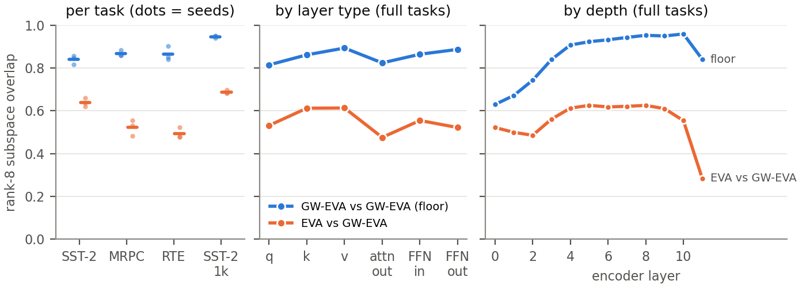
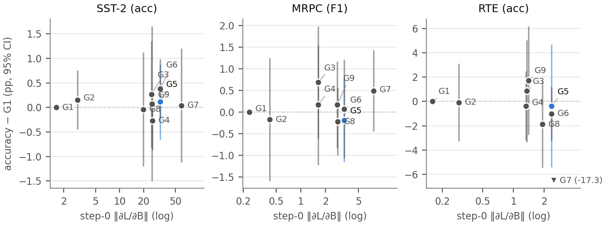
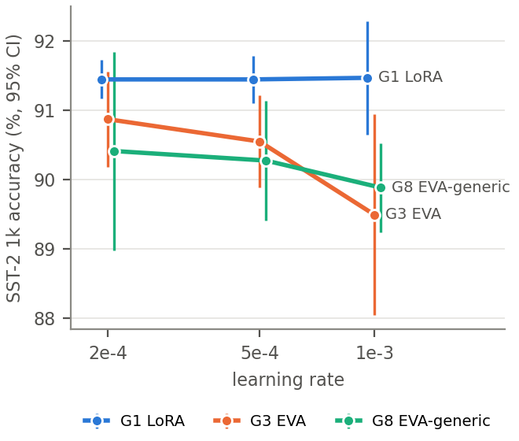
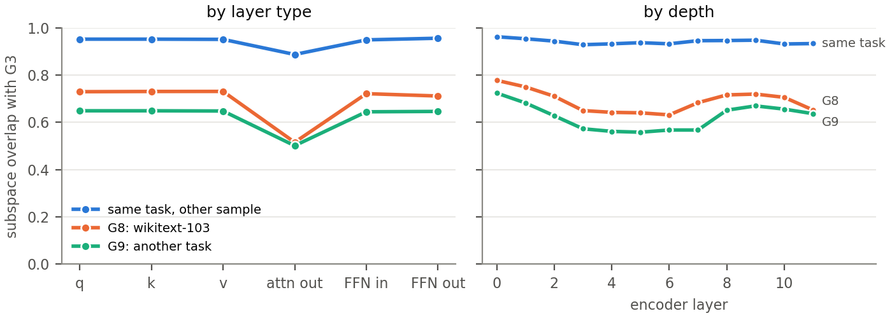

<p align="right"><a href="README.md">English</a> | <b>中文</b></p>

# GW-EVA：去掉独立性假设的梯度加权 LoRA 初始化

AI6103 Deep Learning 小组项目（Option 2：在已有代码库上做改进），六人一组。

- **基础论文**：EVA（Paischer 等，NeurIPS 2025）。它用激活的主成分初始化 LoRA 的 A 矩阵，并按解释方差重新分配各层 rank。
- **代码基础**：作者的官方仓库（MIT 许可），以及 Hugging Face PEFT 中的 EVA 实现。
- **我们的改动**：去掉 EVA 最优性证明中的一个独立性假设，推导出梯度加权的初始化 **GW-EVA**，并在 PEFT 上实现。

## 概览

| | |
|---|---|
| **进度（2026-11-20）** | G1–G9 九组实验和 H1 诊断全部完成并已合并，共约 230 次运行，按种子配对 |
| **主要结果** | 理论成立，GW-EVA 选出的子空间也确实不同于 EVA；但在调好学习率后，GW-EVA 和其他感知数据的初始化都没有在最终精度上胜过普通 LoRA |
| **论文主线** | 分析型论文：“梯度加权的子空间不同，但不影响最终精度；收益只在早期，而且是暂时的” |
| **先看这些** | [报告初稿（英文）](summary/REPORT_DRAFT.md) · [跨组汇总](summary/SUMMARY.zh-CN.md) · [全部表格](summary/tables.md) · [交互式结果页面](#6-交互式结果页面) · [代码运行说明](RUN.zh-CN.md) |

假设检验结论：**H1 成立**（子空间不同），**H2 不成立**（GW-EVA 与 EVA 精度相同），**H3 不成立**（秩分配方式没有影响），**H4 已回答**（子空间是任务相关的，但精度不依赖它）。详见[第 5 节](#5-结果)。

## 快速开始：打开结果页面

结果页面是 [`summary/site/`](summary/site/) 里的静态 HTML 页面，不需要构建，也不需要安装任何包。在仓库根目录运行：

```bash
python -m http.server 8000 --directory summary/site
```

然后在浏览器打开 http://localhost:8000。也可以直接双击 `summary/site/index.html`。详细说明见[第 6 节](#6-交互式结果页面)。

## 1. 研究问题

EVA 的最优性结论（定理 3.2）假设层输出梯度 $g = \partial L / \partial y$ 与输入激活 $x$ 统计独立。

如果不做这个假设，B 在初始化时（B = 0）收到的梯度信号精确等于：

$$
\mathbb{E}\left\Vert \frac{\partial L}{\partial B}\right\Vert _F^2 = \mathrm{Tr}\left(A\,\Sigma_g\,A^\top\right),\qquad
\Sigma_g = \mathbb{E}\left[\Vert g\Vert^2\, x x^\top\right]
$$

所以最优的 A 是 $\Sigma_g$ 的前 r 个特征向量，我们称之为 **GW-EVA**。当 $\Vert g\Vert^2$ 与 $x$ 无关时，它就退化为 EVA。

对大小为 m 的小批量：

$$
\mathbb{E}\left\Vert \bar G_m A^\top\right\Vert _F^2 = \tfrac{1}{m}\mathrm{Tr}\left(A\Sigma_g A^\top\right) + \left(1-\tfrac{1}{m}\right)\left\Vert \mathbb{E}[g x^\top]A^\top\right\Vert _F^2
$$

第二项的最优方向正是 LoRA-GA 用的均值梯度方向。因此 EVA、GW-EVA、LoRA-GA 是同一目标在不同假设下的解。

另一条主线是“LoRA 初始化需要多少任务信息”。按使用的任务信息从少到多，四种初始化排成一条线：

通用语料（G8）→ 别的任务输入（G9）→ 本任务输入（G3，EVA）→ 本任务输入 + 标签梯度（G5，GW-EVA）

## 2. 假设

| | 假设 | 若不成立 |
|---|---|---|
| **H1** | RoBERTa-base 中 $\Vert g\Vert^2$ 与 $x$ 相关，$\Sigma_g$ 与激活协方差的前 r 子空间有可测的差异（第 1 周，不训练即可检验） | 是对 EVA 假设的实证支持，GW-EVA 退化为 EVA，报告负结果 |
| **H2** | 参数量相同时，GW-EVA 第 0 步梯度更大、前 500 步 loss 更低、精度高于 EVA，至少在低资源设置下配对 95% CI 不含 0 | 说明多一次反向传播不值得 |
| **H3** | 按“每参数解释方差”而不是“每个 rank”分配，在固定参数预算下会改变结果（受控因素，不作为创新主张） | 原版按 rank 个数分配已经足够 |
| **H4** | EVA 的激活子空间带有任务特异的信息：把校准数据换成通用语料或别的任务，子空间和精度都会变 | 激活统计主要由模型决定，任务信息只能靠标签梯度引入，反而加强 GW-EVA 的动机 |

## 3. 实验组

核心是“方向 × 分配”的 2×2 因子设计（G3–G6），另加参照组。

| 组 | A 的方向 | rank 分配 | 回答的问题 | 文件夹 | 状态 |
|---|---|---|---|---|---|
| G1 LoRA | Kaiming 随机 | 均匀 r = 8 | 基线 | [`G1G2/`](G1G2/) | 已完成 |
| G2 幅值对照 | 随机正交，行范数与 EVA 相同 | 均匀 r = 8 | 收益来自方向还是幅值 | [`G1G2/`](G1G2/) | 已完成 |
| G3 EVA | 激活协方差 | 按 rank 个数（原版，ρ = 2） | 复现原方法 | [`G3G4/`](G3G4/) | 已完成 |
| G4 | 激活协方差 | 按参数成本 | 只换分配（H3） | [`G3G4/`](G3G4/) | 已完成 |
| G5 GW-EVA | $\Sigma_g$ | 按 rank 个数 | 只换方向（H2） | [`G5G6/`](G5G6/) | 已完成（共享设置；低资源 3 个种子） |
| G6 GW-EVA | $\Sigma_g$ | 按参数成本 | 方向与分配的组合 | [`G5G6/`](G5G6/) | 已完成（共享设置；低资源 3 个种子） |
| G7 LoRA-GA | 均值梯度（B ≠ 0，改写 W） | 均匀 r = 8 | 目标第二项的代表 | [`G7/`](G7/) | 已完成 |
| G8 EVA-generic | 通用语料（wikitext-103）的激活协方差 | 按 rank 个数 | 任务无关的一端（H4） | [`G8/`](G8/) | 已完成（含低资源） |
| G9 EVA-cross | 别的任务的激活协方差（SST-2←MRPC，MRPC←RTE，RTE←MRPC） | 按 rank 个数 | 任务输入有多特异（H4） | [`G9/`](G9/) | 已完成 |

**模型与任务**：RoBERTa-base；GLUE SST-2、MRPC、RTE，另加 1,000 条的低资源 SST-2 子集（G1、G3、G5、G6、G8）。

**H1 诊断**（不训练）：对每个任务和种子，在同一批 1,024 个校准样本上分别计算 EVA 和 GW-EVA，比较 72 层各自的前 8 维子空间，并用两份不相交样本得到噪声基线。文件夹为 [`H1 Diagnosis/`](H1%20Diagnosis/)。

**LoRA 位置与预算**：全部 72 个注意力与 FFN 线性层，预算固定为 **1,327,104** 个可训练参数（即均匀 r = 8 时的参数量）。

## 4. 共享实验设置

所有组必须使用以下设置，以便按种子做配对比较。实现以 `G3G4/src/` 中的 `data.py` 与 `train.py` 为准（G1/G2 已直接复用）。

| 设置 | 取值 |
|---|---|
| 学习率网格 | 2×10⁻⁴、5×10⁻⁴、1×10⁻³ |
| 种子 | SST-2 为 0–2，MRPC / RTE 为 0–4；调参用 0 |
| 训练轮数 | SST-2 3，MRPC 10，RTE 10，低资源 20 |
| 批大小 / 最大长度 / 预热比例 / 权重衰减 | 32 / 128 / 6% / 0；bf16 混合精度；不裁剪梯度 |
| LoRA α / dropout | α = 8（α/r = 1）/ 0；EVA 重分配后 PEFT 按 rank 等比例调整 α，使 α/r 不变 |
| 分类头预热 | 冻结编码器，训练 1 个 epoch，学习率 1×10⁻³ |
| dev 划分 | 训练集的 10%，`SPLIT_SEED = 2026`；低资源 1k 子集用种子 2027 |
| 最终训练数据 | 划掉 dev 后的 90%，与调参一致 |
| EVA 校准 | 训练集中随机 1,024 条，batch 16，去掉 labels；τ = 0.99，ρ = 2 |
| 选参与报告 | 取最后一个 epoch；在 dev 上选参，官方 validation 只在最终评估时使用 |
| 低资源学习率 | 沿用各组在 SST-2 上选出的学习率 |
| 结果格式 | 每次运行一个 JSON，字段见 `G3G4/src/train.py` 末尾 |
| 统计 | 同种子配对差，报告 95% 置信区间（t 分布，df = n − 1） |
| 指标 | SST-2 / RTE 准确率，MRPC F1 与准确率；第 0 步 ‖∂L/∂B‖、前 500 步 loss；初始化耗时、总耗时、峰值显存 |

在 dev 划分上（种子 0）选定的学习率；低资源沿用各组在完整 SST-2 上的选择：

| 组 | SST-2 | MRPC | RTE |
|---|---|---|---|
| G1 | 5e-4 | 2e-4 | 5e-4 |
| G2 | 5e-4 | 1e-3 | 2e-4 |
| G3 | 1e-3 | 2e-4 | 2e-4 |
| G4 | 5e-4 | 2e-4 | 2e-4 |
| G5 | 1e-3 | 2e-4 | 2e-4 |
| G6 | 5e-4 | 2e-4 | 2e-4 |
| G7 | 2e-4 | 2e-4 | 2e-4 |

G8 / G9 沿用 G3 的学习率。

## 5. 结果

所有组都按上面的共享设置运行，可以按种子配对比较。完整表格、配对差、可比性说明和尚缺的部分见 [`summary/SUMMARY.zh-CN.md`](summary/SUMMARY.zh-CN.md)，可用 `python summary/collect.py` 重新生成。

官方 validation，mean ± sd（%）；SST-2 3 个种子，MRPC / RTE 5 个，低资源 5 个（G5/G6 为 3 个）：

| 任务 | G1 LoRA | G2 | G3 EVA | G4 | G5 GW-EVA | G6 | G7 LoRA-GA | G8 | G9 |
|---|---|---|---|---|---|---|---|---|---|
| SST-2 (acc) | 93.92 ± 0.00 | 94.07 ± 0.24 | 94.19 ± 0.43 | 93.65 ± 0.24 | 94.04 ± 0.30 | **94.30 ± 0.24** | 93.96 ± 0.46 | 93.88 ± 0.46 | 94.00 ± 0.63 |
| MRPC (F1) | 91.34 ± 0.43 | 91.16 ± 1.11 | **92.02 ± 0.79** | 91.50 ± 0.68 | 91.14 ± 0.69 | 91.41 ± 0.52 | 91.83 ± 0.46 | 91.11 ± 0.34 | 91.50 ± 0.60 |
| RTE (acc) | 73.94 ± 2.10 | 73.86 ± 1.04 | 74.80 ± 2.49 | 73.57 ± 2.06 | 73.57 ± 2.43 | 72.92 ± 2.09 | 56.68 ± 8.85 | 72.06 ± 2.18 | **75.67 ± 1.70** |
| 低资源 SST-2 1k (acc) | **91.44 ± 0.28** | – | 88.81 ± 0.83 | – | 88.46 ± 0.29 | 89.98 ± 0.18 | – | 89.89 ± 0.52 | – |

配对差（百分点，95% CI；`*` 表示区间不含 0）：

| 比较 | SST-2 | MRPC | RTE | 低资源 |
|---|---|---|---|---|
| G5 − G3（H2） | −0.15 [−1.07, +0.76] | −0.88 [−2.05, +0.29] | −1.23 [−4.09, +1.64] | −0.46 [−3.82, +2.90] |
| G3 − G1 | +0.27 [−0.81, +1.35] | +0.68 [−0.60, +1.97] | +0.87 [−3.27, +5.01] | −2.64 [−3.70, −1.57] * |
| G5 − G1 | +0.11 [−0.64, +0.87] | −0.20 [−1.14, +0.75] | −0.36 [−5.35, +4.63] | −3.10 [−3.59, −2.60] * |
| G7 − G1 | +0.04 [−1.11, +1.19] | +0.49 [−0.44, +1.41] | −17.26 [−27.93, −6.59] * | – |
| G3 − G1，同为 lr 2e-4、同一张显卡⁵ | – | – | – | −0.57 [−1.45, +0.30] |

| 假设 | 结论 |
|---|---|
| H1：Σ_g 的子空间不同于 EVA | **成立**：在同一批校准样本上，前 8 维子空间重合度为 0.49–0.69，GW–GW 噪声基线为 0.84–0.95，四个任务都显著（`H1 Diagnosis/`） |
| H2：GW-EVA 优于 EVA | **不成立**：G5 − G3 处处不显著，均值略为负，早期 loss 也不更低，尽管 GW-EVA 第 0 步梯度是 EVA 的 1.3–2.1 倍 |
| H3：按成本分配有影响 | **不成立**：G4 − G3、G6 − G5 都不显著；低资源下均匀秩的 EVA 与原版相同 |
| H4：任务输入有多特异 | **已回答**：用别的任务（G9）或通用的 wikitext-103 文本（G8）校准的 EVA，与用本任务数据校准的精度相同，尽管它们的子空间重合度只有 0.49–0.72，而同任务的噪声基线为 0.92–0.95 |

⁵ 来自 [`summary/SUMMARY.zh-CN.md`](summary/SUMMARY.zh-CN.md) 中的低资源对照，不属于共享协议；2e-4 是 EVA 在低资源上最好的学习率，G1 在各学习率下结果相同。

主要发现：

- **GW-EVA 的子空间确实不同于 EVA（H1）。** 在同一批校准样本上，前 8 维子空间重合度为 0.49–0.69，而两份不相交样本各自得到的 GW-EVA 之间为 0.84–0.95；864 个“层 × 种子”中只有 7 个达到基线。逐 token 看，‖g‖² 与 ‖x‖² 只有弱相关（Pearson 0.10–0.19）。
- **完整数据上，没有任何初始化优于普通 LoRA。** 除 G7 外，各组与 G1 的差都在 ±1.9 分以内，区间都包含 0，其中也包括用别的任务（G9）或通用文本（G8）校准的 EVA。
- **感知数据的初始化在早期拟合更快，但优势不能保持。** MRPC 上学习率相同时，EVA、GW-EVA、LoRA-GA 前 500 步的训练 loss 都显著低于 LoRA，最终 F1 却没有差别。GW-EVA 在任何阶段都不比 EVA 快。
- **更大的初始梯度换不来精度。** 从 G1 到各种感知数据的初始化，第 0 步 B 的梯度增大 7–37 倍；只匹配 EVA 的幅值（G2）、用 EVA 的方向（G3）或再加上标签梯度（G5），精度都不变。
- **只有 1k 样本时，谱初始化差于 LoRA，完全是学习率的原因。** 按共享规则，G3 比 G1 低 2.64（G5 −3.10，G6 −1.57，G8 −1.56）。LoRA 对学习率不敏感，EVA 却适合更低的学习率：两者都用 2e-4 时，差距缩小到 −0.57，不显著。去掉 EVA 的秩重分配不改变结果；loss 曲线显示高学习率下 EVA 在第 51–200 步拟合更慢。
- **同显卡、同学习率时，EVA 只在 RTE 上更好。** MRPC 上 10 个种子时看似的优势来自显卡差异（15 个种子全部在 L40S 上时 G3 − G1 = +0.14，不显著）。RTE 上都用 lr 2e-4 时 G3 − G1 = +2.13 [+0.97, +3.29]；但 LoRA 用自己调出的 5e-4 时差异不显著。
- **RTE 上的训练很脆弱。** LoRA-GA 在 RTE 上平均只有 56.68（一个种子单类塌缩，两个接近随机）；但 G1 补到 10 个种子后，普通 LoRA 也有 1 个种子塌缩，见 [`summary/SUMMARY.zh-CN.md`](summary/SUMMARY.zh-CN.md) 第 2 节第 7 条。
- **A 从哪些方向出发基本不重要。** 梯度加权（H1）和换一份数据校准（H4：G8 与 EVA 的重合度为 0.64–0.72，G9 为 0.49–0.66，基线为 0.92–0.95）都会改变 EVA 子空间的三分之一到一半，但都不改变精度。

### 图

由 `python summary/figures.py` 生成到 [`summary/figures/`](summary/figures/)（PNG 和 PDF），编号与报告初稿一致。

| | |
|---|---|
|  | **图 1：H1。** 同一批样本上 GW-EVA 与 EVA 的重合度（橙色）对比 GW-EVA 噪声基线（蓝色），按任务、层类型和深度展示。 |
|  | **图 2。** 第 0 步 ‖∂L/∂B‖（对数）与相对 LoRA 的精度差：梯度增大 7–37 倍，精度不变。 |
|  | **图 3。** 同一张显卡上，低资源 SST-2 精度随学习率的变化：LoRA 基本不变，EVA 在更低学习率下回升。 |
|  | **图 4：H4。** 同任务不相交样本、G8、G9 与本任务 EVA 的重合度，按层类型和深度展示。 |

### 已知局限

- H1 比较的是中心化的 EVA 与未中心化的 Σ<sub>g</sub>，所以中心化与梯度加权的作用还没有分开。
- 各组用的显卡不同（A40、L40S、笔记本显卡），跨显卡时单个种子最多相差 2.5 分，因此结论以同显卡核查为准。
- G5/G6 在低资源上只有 3 个种子，也没有低资源学习率对照。
- 没有做多重比较校正（每张表约 20 个比较）。

完整列表及各项的影响见 [`summary/SUMMARY.zh-CN.md`](summary/SUMMARY.zh-CN.md) 第 3–4 节。

## 6. 交互式结果页面

[`summary/site/`](summary/site/) 是一个英文结果页面，可用于展示和核对数字。它用交互图表展示上面的全部结果，并在浏览器里现算配对差的 95% 置信区间，算法与 `collect.py` 相同。

| 文件 | 作用 |
|---|---|
| `index.html` | 页面本身：HTML、CSS 和原生 JavaScript，不依赖任何库 |
| `data.js` | 所有运行、H1/H4 重合度和 loss 曲线，由运行 JSON 生成 |
| `build_data.py` | 重新生成 `data.js`（只用标准库） |

**打开方式**（任选一种）：

1. **直接打开。** 双击 `summary/site/index.html`；或在仓库根目录运行 `open summary/site/index.html`（macOS）、`xdg-open summary/site/index.html`（Linux）、`start summary\site\index.html`（Windows）。页面从同目录读取 `data.js`，所以离线也能用；没有网络时只有网页字体会换成系统字体。
2. **本地起服务**（只需 Python 3，无需安装）：

   ```bash
   python -m http.server 8000 --directory summary/site
   ```

   然后打开 http://localhost:8000。8000 端口被占用时换一个端口即可，按 Ctrl+C 停止服务。

**页面内容：**

| 节 | 内容 |
|---|---|
| 01 Verdict | H1–H4 的结论和主要发现 |
| 02 Groups | 九种初始化；颜色表示 A 的方向所属的类别，标记形状区分组 |
| 03 Main results | 选择任务和基线（G1、G3 或 G5）：配对差的森林图、每个种子的结果、mean ± sd 表 |
| 04 Low resource | G1、G3、G8 的精度随学习率的变化（另有 G5/G6 在共享学习率下的结果） |
| 05 Same-GPU checks | 在同一张显卡、相同学习率下重跑的比较 |
| 06 Early training | 前 500 步的 loss 曲线，以及相对所选参照组的分段差值 |
| 07 Step-0 gradient | 第 0 步 ‖∂L/∂B‖ 与精度的关系，以及 √3 理论检验 |
| 08 Subspaces (H1) | 各任务上 GW-EVA 与 EVA 的重合度、带置信区间的表格、层类型 × 深度热力图 |
| 09 Subspaces (H4) | G8、G9 和噪声基线与本任务 EVA 的重合度，按任务和按层展示 |
| 10 Setup & caveats | 共享设置、注意事项和重新生成所有结果的命令 |

鼠标悬停在任何标记上可以看到精确数值。页面跟随系统的浅色/深色主题，手机上也能正常查看。

**有新的运行结果后**，在仓库根目录重新生成数据，再刷新页面：

```bash
python summary/site/build_data.py
```

该脚本读取与 `collect.py` 相同的运行 JSON（`*/results/…` 和 `H1 Diagnosis/results/`），重写 `summary/site/data.js`。如果图表是空的，先检查 `index.html` 旁边是否有 `data.js`。

## 7. 文档

| 文件 | 内容 |
|---|---|
| [`summary/REPORT_DRAFT.md`](summary/REPORT_DRAFT.md) | 完整的英文报告初稿：方法、设计、结果（表 1–7、图 1–4）、讨论；TODO 标出还需全组补充的地方 |
| [`summary/SUMMARY.zh-CN.md`](summary/SUMMARY.zh-CN.md) | 跨组汇总：十条发现、假设结论、可比性说明、尚缺的部分 |
| [`summary/tables.md`](summary/tables.md) | 所有自动生成的表格，包括全部配对差和对照 |
| [`summary/all_runs.csv`](summary/all_runs.csv) | 共享协议下每次运行一行 |
| [`summary/NEXT_STEPS.zh-CN.md`](summary/NEXT_STEPS.zh-CN.md) | 计划及进度，以及确定论文主线的决策表 |
| `G*/README.md`、[`H1 Diagnosis/README.md`](H1%20Diagnosis/README.md) | 各组的实现细节和运行方式 |

## 8. 仓库组织

每人在自己的分支上工作，每两组实验一个文件夹，包含代码、Slurm 脚本和结果 JSON；`main` 现在合并了所有分支。大文件（模型权重、数据、EVA 缓存、日志）不进 git，用 `.gitignore` 排除。

| 文件夹 | 内容 | 来源分支 |
|---|---|---|
| `G1G2/` | G1 LoRA 基线、G2 幅值对照、G1 扩展种子、G1 和 G3 的低资源对照 | `yxh` |
| `G3G4/` | G3 EVA 复现、G4 按参数成本分配；共享的数据划分与训练管线 | `yinchenyu_g3g4` |
| `G5G6/` | 共享设置下的 G5 / G6 GW-EVA | `hanyanze` |
| `G7/` | G7 LoRA-GA | `liyouran` |
| `G8/` | G8 EVA-generic（按 G3 的 token 排布用 wikitext-103 校准）及其与 G3 的子空间重合度 | `eddy_G8` |
| `G9/` | G9 EVA-cross 及 H4 子空间重合度 | `zjz_g9` |
| `H1 Diagnosis/` | H1：在同一批校准样本上比较 GW-EVA 与 EVA 的子空间，附 GW–GW 噪声基线 | `hanyanze` |
| `summary/` | 跨组表格（`collect.py`）、报告用图、发现与后续计划、报告初稿和交互式结果页面（`site/`） | `summary` |

## 9. 复现

**完整说明见 [`RUN.zh-CN.md`](RUN.zh-CN.md)：** 包括所有组共用的环境（[`requirements.txt`](requirements.txt)）、数据准备、覆盖每一组的冒烟测试（`tools/smoke_test.py`），以及各组的运行命令。

重新生成表格、图和页面不需要 GPU。在仓库根目录用 Python 3 运行（`figures.py` 还需要 matplotlib）：

```bash
python summary/collect.py          # summary/tables.md 和 summary/all_runs.csv
python summary/figures.py          # summary/figures/*.png 和 *.pdf（图 1–4）
python summary/site/build_data.py  # 结果页面用的 summary/site/data.js
```

这些脚本只读取仓库里的结果 JSON。重新跑实验需要 GPU、根目录的 `requirements.txt`，以及下载好的模型和数据，每一步见 [`RUN.zh-CN.md`](RUN.zh-CN.md)。H1 还需要 G5/G6 study 生成的分类头检查点，它们不在 git 里。

## 10. 计算资源

CCDS GPU Cluster TC2，Slurm 调度。每人的 QoS 为 1 张 GPU、最多 2 个作业、30 GB 内存，单个作业不超过 6 小时。每个作业把多次训练打包，在同一张卡上并行 2 个进程；每次训练结束立刻写出 JSON，重新提交即可续跑。

## 11. 课程要求摘要

- Option 2：选 2019 年及以后、有公开代码的论文，在其基础上实现改进，允许复用原代码。
- 不得与组员个人项目的“模型 + 数据集”组合重复。
- 不得刻意压低基线结果。
- 评分共 30 分：新颖性与难度 10、技术方案 10、写作 10。
